<p align="left"></p>

# AgroCusco Directo

**Facultad de Ingeniería · Escuela Académico Profesional de Ingeniería de Sistemas e Informática**
**Cloud Computing – Producto Académico N.º 3 (Evaluación para el consolidado 2)**

Plataforma web de microservicios para conectar a productores agrícolas de Cusco con compradores.

**Autores**

- Francys Raúl Tejada Taco
- Andrea Alejandra Hermoza Guevara
- Albert Levita Zea
- Beder Edison Achiri Sillo
- Wilder Ronald Ccasani Quispe

Cusco, 2026

---

## 1. Introducción

AgroCusco Directo es una plataforma web que conecta directamente a los pequeños productores agrícolas de la región Cusco con restaurantes, comercios y familias. La idea es que el agricultor deje de depender de intermediarios y reciba un precio justo, y que quien compra pueda ver qué productos hay disponibles y de dónde vienen. Se pensó como una solución liviana, porque en las zonas rurales la conexión a Internet no siempre es buena.

El sistema está hecho con microservicios: usuarios, productos, pedidos y notificaciones. Cada uno se desarrolla, se prueba y se ejecuta por separado, y se comunican entre sí por HTTP. En este informe se explica cómo se planteó el proyecto, cómo trabajamos en GitHub, cómo quedó cada servicio, las pruebas que hicimos y cómo se contenerizó todo con Docker.

## 2. Contexto y problemática

El proyecto está pensado para la región Cusco, donde buena parte de la producción agrícola la hacen familias de pequeños productores. Muchos venden a intermediarios que ponen el precio de compra, así que al agricultor le queda solo una parte de lo que el producto vale al final, y el comprador casi nunca sabe quién lo cultivó ni cuánto hay realmente disponible.

A esto se suma que en el campo la señal de Internet es irregular y la mayoría usa el celular, no una computadora. Por eso la plataforma debe funcionar con poco consumo de datos y ser fácil de usar. La necesidad que identificamos es un canal directo entre productor y comprador, con stock visible y con seguimiento del estado de cada pedido.

## 3. Usuarios objetivo

La plataforma tiene tres tipos de usuario, que coinciden con los roles del sistema. Los productores son los pequeños agricultores de Cusco que publican sus productos y administran su stock. Los compradores son restaurantes, comercios y familias que quieren productos frescos a precio justo. Los administradores son quienes supervisan la plataforma.

## 4. Propuesta de solución

Un productor se registra, publica sus productos con categoría, precio, stock y zona, y un comprador revisa el catálogo y hace su pedido. Cuando se crea un pedido, el sistema comprueba que el comprador exista y que haya stock suficiente; si todo está bien, descuenta el stock y avisa al comprador. Luego el pedido pasa por los estados Pendiente, Aceptado, En camino y Entregado, y en cada cambio se envía una notificación.

Para cuidar el consumo de datos, los servicios intercambian mensajes JSON pequeños y no devuelven información innecesaria (por ejemplo, nunca se devuelve la contraseña). Cada servicio tiene además un endpoint `/health` para saber si está funcionando.

## 5. Microservicios

Identificamos cuatro servicios, cada uno con una función concreta:

| Microservicio | Tecnología | Puerto local | Responsabilidad |
|---|---|---|---|
| usuarios-service | Node.js / Express | 8001 | Registro, autenticación (login) y roles: productor, comprador y administrador. |
| productos-service | Node.js / Express, MySQL | 8002 | Publicación, categorías, precios y control de stock del catálogo agrícola. |
| pedidos-service | Node.js / Express | 8003 | Creación y seguimiento de pedidos, con validación automática de stock. |
| notificaciones-service | Python / FastAPI | 8004 | Envío y registro de alertas por pedidos nuevos y cambios de estado. |

La comunicación es síncrona, con peticiones HTTP entre servicios. Cuando llega un pedido, pedidos-service consulta a usuarios-service (`GET /usuarios/:id`) para validar al comprador, consulta y actualiza el stock en productos-service, y envía el aviso a notificaciones-service. Si notificaciones falla, el pedido no se cancela: solo se deja un aviso en la consola.

## 6. Repositorio y trabajo en equipo

Todo el código está en un repositorio público de GitHub llamado Microservicios-AgroCusco. El README.md lo creó Albert Levita Zea, y uno de nosotros hace de líder: administra el repositorio y revisa lo que manda el resto. Cada integrante hizo un fork, trabajó en su propia rama (por ejemplo `feature/usuarios-service`) y envió sus cambios con un Pull Request al repositorio central, donde el líder los revisa antes de fusionarlos. Para que la rama main solo reciba cambios por Pull Request con al menos una aprobación, se configura la protección de rama en Settings → Branches.

En la captura siguiente se ve el repositorio con los 3 forks y las carpetas de los servicios. Hasta ahora se fusionaron cuatro Pull Requests, uno por servicio:

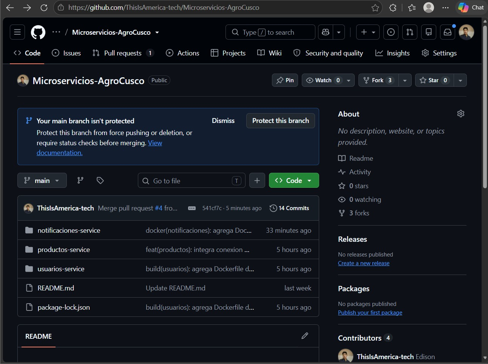

| PR | Servicio | Rama de origen | Commits |
|---|---|---|---|
| #1 | pedidos-service | feature/pedidos-service | 3 |
| #2 | usuarios-service | feature/usuarios-service | 3 |
| #3 | productos-service | productos | 3 |
| #4 | notificaciones-service | feature/notificaciones-service | 3 |

La siguiente captura muestra el Pull Request n.º 2, «feat: agrega usuarios-service», ya fusionado en main. Se puede ver su descripción y los tres commits que incluye.

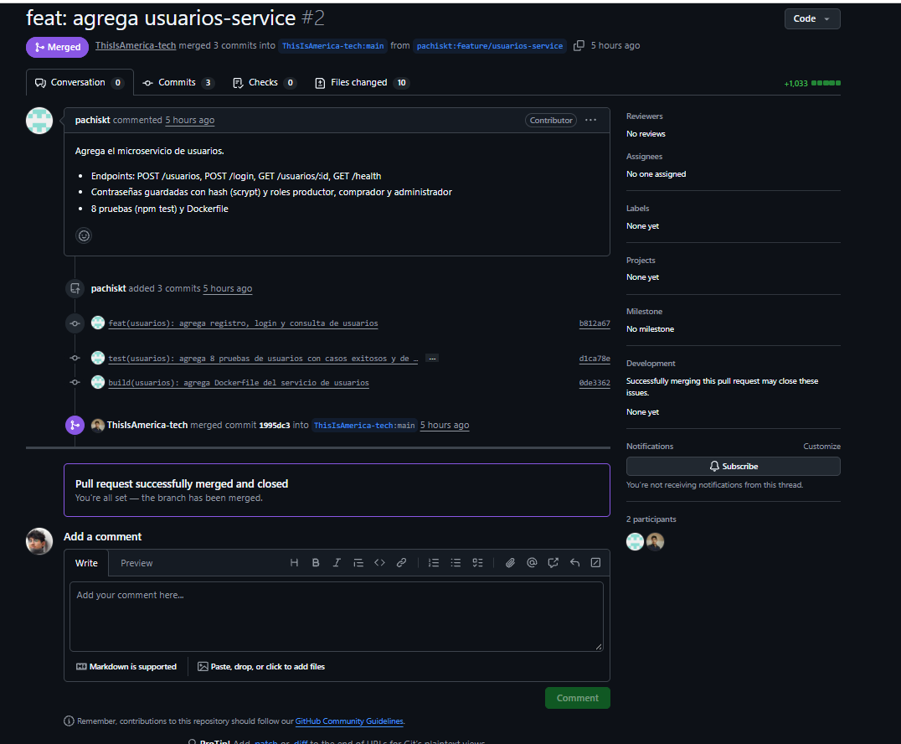

Usamos mensajes de commit con prefijos (feat, test, build, docker, fix) para que se entienda qué hizo cada cambio. Por ejemplo, en cada servicio hay un commit de la funcionalidad, otro de las pruebas y otro del Dockerfile.

## 7. Desarrollo de los microservicios

### 7.1 usuarios-service

Está hecho en Node.js con Express. Por ahora guarda los usuarios en memoria, así que se borran cuando se reinicia el contenedor. Tiene estos endpoints:

| Método | Ruta | Descripción |
|---|---|---|
| GET | /health | Responde 200 con el nombre del servicio. |
| POST | /usuarios | Registra un usuario (nombre, email, clave de mínimo 6 caracteres y rol). Devuelve 201; 400 si los datos son inválidos y 409 si el email ya existe. |
| POST | /login | Inicia sesión con email y clave. Devuelve 200 con un token; 401 si las credenciales no coinciden. |
| GET | /usuarios/:id | Devuelve el usuario (200) o 404. Lo usa pedidos-service para validar al comprador. |

La siguiente captura es el commit donde se agregaron el registro, el login y la consulta de usuarios.

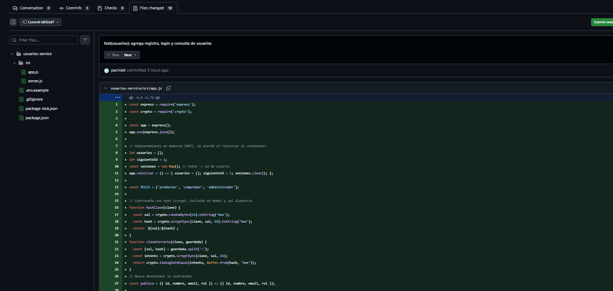

Las contraseñas no se guardan tal cual: se les aplica un hash con scrypt (que viene incluido en Node) y una sal aleatoria distinta para cada usuario. Al hacer login se compara con `timingSafeEqual`, y las respuestas nunca incluyen la clave. Además, el mensaje de error del login es el mismo si falla el email o la clave, para no revelar qué emails existen. Este es el código principal de `src/app.js`:

```js
const ROLES = ['productor', 'comprador', 'administrador'];

// Contraseña con hash (scrypt, incluido en Node) y sal aleatoria
function hashClave(clave) {
  const sal = crypto.randomBytes(16).toString('hex');
  const hash = crypto.scryptSync(clave, sal, 64).toString('hex');
  return `${sal}:${hash}`;
}
function claveCorrecta(clave, guardada) {
  const [sal, hash] = guardada.split(':');
  const intento = crypto.scryptSync(clave, sal, 64);
  return crypto.timingSafeEqual(intento, Buffer.from(hash, 'hex'));
}

// Nunca devolvemos la contraseña
const publico = ({ id, nombre, email, rol }) => ({ id, nombre, email, rol });

app.post('/usuarios', (req, res) => {
  const { nombre, email, clave, rol } = req.body || {};
  if (typeof nombre !== 'string' || !nombre.trim()
      || typeof email !== 'string' || !email.includes('@')
      || typeof clave !== 'string' || clave.length < 6
      || !ROLES.includes(rol)) {
    return res.status(400).json({ error: 'Datos inválidos: ...' });
  }
  if (usuarios.some((u) => u.email === email.toLowerCase())) {
    return res.status(409).json({ error: 'Ya existe un usuario con ese email' });
  }
  const usuario = { id: siguienteId++, nombre: nombre.trim(),
    email: email.toLowerCase(), rol, clave: hashClave(clave) };
  usuarios.push(usuario);
  res.status(201).json(publico(usuario));
});

app.post('/login', (req, res) => {
  const { email, clave } = req.body || {};
  const usuario = usuarios.find((u) => typeof email === 'string'
    && u.email === email.toLowerCase());
  if (!usuario || typeof clave !== 'string'
      || !claveCorrecta(clave, usuario.clave)) {
    return res.status(401).json({ error: 'Email o clave incorrectos' });
  }
  const token = crypto.randomBytes(24).toString('hex');
  sesiones.set(token, usuario.id);
  res.json({ token, usuario: publico(usuario) });
});

app.get('/usuarios/:id', (req, res) => {
  const usuario = usuarios.find((u) => u.id === Number(req.params.id));
  if (!usuario) return res.status(404).json({ error: 'Usuario no encontrado' });
  res.json(publico(usuario));
});
```

### 7.2 productos-service

También está en Node.js con Express, pero este sí guarda los datos en una base MySQL (tabla productos, creada con el script `db/init.sql`). Se conecta con un pool de conexiones configurable por variables de entorno (`DB_HOST`, `DB_USER`, `DB_PASSWORD`, `DB_NAME`).

| Método | Ruta | Descripción |
|---|---|---|
| GET | /productos | Lista todos los productos del catálogo. |
| POST | /productos | Crea un producto (nombre, categoría, precio, stock y zona). Devuelve 201. |
| PUT | /productos/:id | Actualización de un producto (pendiente de implementar la lógica completa). |
| PATCH | /productos/:id/stock | Modifica el stock de un producto; 404 si no existe. |
| GET | /health | Responde 200 con el nombre del servicio. |

```js
const dbPool = mysql.createPool({
    host: process.env.DB_HOST || 'localhost',
    user: process.env.DB_USER || 'root',
    password: process.env.DB_PASSWORD || 'root',
    database: process.env.DB_NAME || 'agro_productos',
    waitForConnections: true,
    connectionLimit: 10,
    queueLimit: 0
});

app.get('/productos', async (req, res) => {
    try {
        const [rows] = await dbPool.query('SELECT * FROM productos');
        res.json(rows);
    } catch (error) {
        res.status(500).json({ error: "Error al obtener productos" });
    }
});

app.post('/productos', async (req, res) => {
    const { nombre, categoria, precio, stock, zona } = req.body;
    try {
        const [result] = await dbPool.query(
            'INSERT INTO productos (nombre, categoria, precio, stock, zona) VALUES (?, ?, ?, ?, ?)',
            [nombre, categoria, precio, stock, zona]
        );
        res.status(201).json({ message: "Producto creado", id: result.insertId });
    } catch (error) {
        res.status(500).json({ error: "Error al crear producto" });
    }
});
```

Script de la base de datos (`db/init.sql`):

```sql
CREATE TABLE IF NOT EXISTS productos (
    id INT AUTO_INCREMENT PRIMARY KEY,
    nombre VARCHAR(100) NOT NULL,
    categoria VARCHAR(50) NOT NULL,
    precio DECIMAL(10, 2) NOT NULL,
    stock INT NOT NULL,
    zona VARCHAR(100) NOT NULL
);
```

### 7.3 pedidos-service

Es el servicio que coordina a los demás. Guarda los pedidos en memoria y, para crear uno, consulta a usuarios-service y productos-service y avisa a notificaciones-service. Las llamadas HTTP están separadas en el archivo `src/clientes.js`, con un tiempo máximo de espera de 5 segundos; así, en las pruebas se pueden reemplazar por funciones simuladas sin necesitar los otros servicios.

| Método | Ruta | Descripción |
|---|---|---|
| POST | /pedidos | Crea un pedido: valida comprador y stock, descuenta stock y notifica. 201 si sale bien; 400, 404 o 503 según el caso. |
| GET | /pedidos | Lista los pedidos; acepta el filtro `?comprador_id=`. |
| GET | /pedidos/:id | Consulta un pedido (200 o 404). |
| PATCH | /pedidos/:id/estado | Cambia el estado respetando las transiciones permitidas. |
| GET | /health | Responde 200 con el nombre del servicio. |

Las transiciones de estado están restringidas: un pedido Pendiente solo puede pasar a Aceptado o Rechazado, uno Aceptado a En camino, y uno En camino a Entregado. Cualquier otro salto devuelve 400.

```js
// Estados permitidos y a cuáles se puede pasar desde cada uno
const TRANSICIONES = {
  'Pendiente': ['Aceptado', 'Rechazado'],
  'Aceptado': ['En camino'],
  'En camino': ['Entregado'],
};

// Crear pedido: valida usuario y stock, descuenta stock y notifica
app.post('/pedidos', async (req, res) => {
  const { comprador_id, items } = req.body || {};
  // ... validación de datos (400 si faltan campos o la cantidad es <= 0)
  try {
    if (!(await clientes.validarUsuario(comprador_id))) {
      return res.status(404).json({ error: 'El comprador no existe' });
    }
    for (const it of items) {
      const prod = await clientes.obtenerProducto(it.producto_id);
      if (!prod) return res.status(404).json({ error: `El producto ${it.producto_id} no existe` });
      if (prod.stock < it.cantidad) {
        return res.status(400).json({ error: `Stock insuficiente de ${prod.nombre}` });
      }
      total += prod.precio * it.cantidad;
      detalles.push({ producto_id: it.producto_id, cantidad: it.cantidad,
                      precio_unitario: prod.precio });
    }
    for (const it of items) {
      await clientes.descontarStock(it.producto_id, it.cantidad);
    }
  } catch (e) {
    return res.status(503).json({ error: 'Un servicio dependiente no responde' });
  }
  // ... se guarda el pedido con estado 'Pendiente' y se notifica al comprador
});

// Cambiar estado del pedido
app.patch('/pedidos/:id/estado', async (req, res) => {
  const pedido = pedidos.find((p) => p.id === Number(req.params.id));
  if (!pedido) return res.status(404).json({ error: 'Pedido no encontrado' });
  const nuevo = (req.body || {}).estado;
  if (!(TRANSICIONES[pedido.estado] || []).includes(nuevo)) {
    return res.status(400).json({ error: `No se puede pasar de ${pedido.estado} a ${nuevo}` });
  }
  pedido.estado = nuevo;
  await clientes.notificar(pedido.comprador_id, `Tu pedido #${pedido.id} ahora está: ${nuevo}`);
  res.json(pedido);
});
```

Fragmento de `src/clientes.js`, con las direcciones de los otros servicios y el manejo de errores:

```js
const USUARIOS_URL = process.env.USUARIOS_URL || 'http://usuarios:8000';
const PRODUCTOS_URL = process.env.PRODUCTOS_URL || 'http://productos:8000';
const NOTIFICACIONES_URL = process.env.NOTIFICACIONES_URL || 'http://notificaciones:8000';
const TIMEOUT_MS = 5000;

async validarUsuario(id) {
  const r = await fetch(`${USUARIOS_URL}/usuarios/${id}`,
    { signal: AbortSignal.timeout(TIMEOUT_MS) });
  if (r.status === 404) return false;
  if (!r.ok) throw new Error(`usuarios-service respondió ${r.status}`);
  return true;
},

// Una falla de notificaciones NO debe romper el pedido.
async notificar(usuario_id, mensaje) {
  try {
    await fetch(`${NOTIFICACIONES_URL}/notificaciones`, { method: 'POST', ... });
  } catch (e) {
    console.warn('No se pudo notificar:', e.message);
  }
},
```

### 7.4 notificaciones-service

Este servicio está hecho en Python con FastAPI, a diferencia de los demás, y guarda las notificaciones en una lista en memoria. Cada notificación tiene un usuario, un mensaje, un tipo (por defecto PEDIDO) y un estado ENVIADO.

| Método | Ruta | Descripción |
|---|---|---|
| GET | /health | Responde con el estado UP y el nombre del servicio. |
| POST | /notificaciones | Registra y «envía» una notificación; devuelve 201. |
| GET | /notificaciones/{usuario} | Devuelve las notificaciones de un usuario y el total. |

```python
app = FastAPI(title="Notificaciones Service - AgroCusco Directo")
db_notificaciones = []

class NotificacionSchema(BaseModel):
    usuario: str
    mensaje: str
    tipo: str = "PEDIDO"

@app.get("/health")
def health_check():
    return {"status": "UP", "service": "notificaciones-service"}

@app.post("/notificaciones", status_code=status.HTTP_201_CREATED)
def enviar_notificacion(notificacion: NotificacionSchema):
    if not notificacion.usuario or not notificacion.mensaje:
        raise HTTPException(status_code=400, detail="El usuario y mensaje son obligatorios")
    nueva = {
        "id": len(db_notificaciones) + 1,
        "usuario": notificacion.usuario,
        "mensaje": notificacion.mensaje,
        "tipo": notificacion.tipo,
        "estado": "ENVIADO"
    }
    db_notificaciones.append(nueva)
    return nueva

@app.get("/notificaciones/{usuario}")
def obtener_notificaciones(usuario: str):
    user_notifs = [n for n in db_notificaciones if n["usuario"] == usuario]
    return {"usuario": usuario, "notificaciones": user_notifs, "total": len(user_notifs)}
```

## 8. Pruebas

En usuarios-service y pedidos-service las pruebas se hacen con el ejecutor de pruebas que trae Node (`node --test`) y el módulo `node:assert`, sin instalar nada más. Cada prueba levanta el servidor en un puerto libre y reinicia los datos antes de correr, así que no dependen unas de otras. En notificaciones-service se usa pytest con el TestClient de FastAPI. Las pruebas de Node se ejecutan con `npm test` y las de Python con `pytest`.

### 8.1 Pruebas de usuarios-service

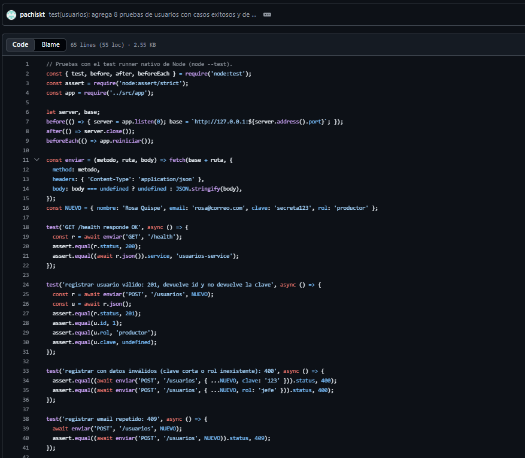

| N.º | Prueba | Comportamiento que se espera |
|---|---|---|
| 1 | GET /health responde OK | Estado 200 y service igual a usuarios-service. |
| 2 | Registrar usuario válido | Estado 201, id asignado, rol correcto y sin devolver la clave. |
| 3 | Registrar con datos inválidos | Estado 400 con clave corta o con un rol que no existe. |
| 4 | Registrar email repetido | Estado 409 al registrar dos veces el mismo email. |
| 5 | Login correcto | Estado 200 y se devuelve un token. |
| 6 | Login con clave incorrecta | Estado 401. |
| 7 | Login con email inexistente | Estado 401. |
| 8 | Consultar usuario | Estado 200 con el email correcto si existe; 404 si no existe. |

```js
// Pruebas con el test runner nativo de Node (node --test).
const { test, before, after, beforeEach } = require('node:test');
const assert = require('node:assert/strict');
const app = require('../src/app');

let server, base;
before(() => { server = app.listen(0);
  base = `http://127.0.0.1:${server.address().port}`; });
after(() => server.close());
beforeEach(() => app.reiniciar());

test('registrar email repetido: 409', async () => {
  await enviar('POST', '/usuarios', NUEVO);
  assert.equal((await enviar('POST', '/usuarios', NUEVO)).status, 409);
});

test('login con clave incorrecta: 401', async () => {
  await enviar('POST', '/usuarios', NUEVO);
  assert.equal((await enviar('POST', '/login',
    { email: NUEVO.email, clave: 'otra-clave' })).status, 401);
});
```

### 8.2 Pruebas de pedidos-service

Aquí los otros servicios se simulan, reemplazando las funciones de `clientes.js`, para probar solo la lógica de pedidos.

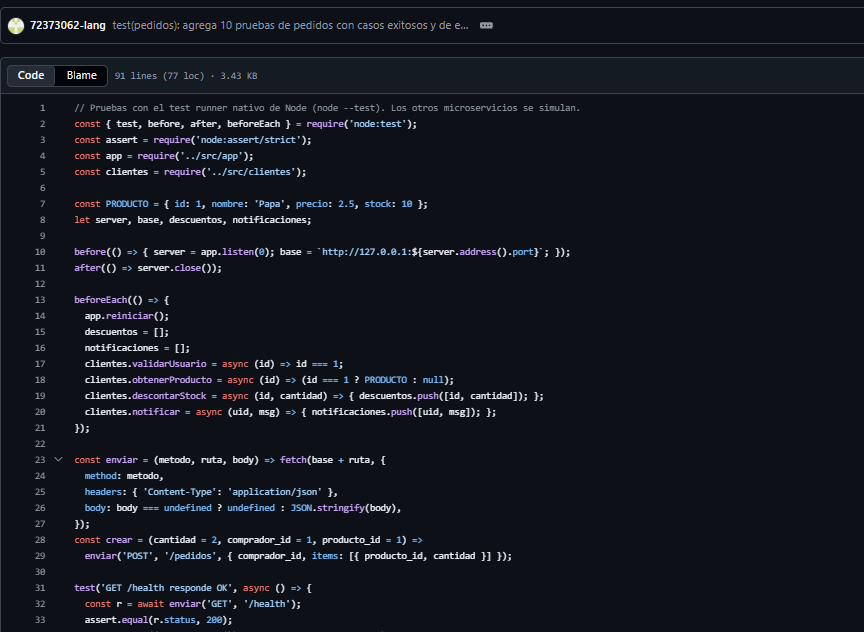

Al ejecutar `npm test` dentro de la carpeta pedidos-service pasan las 10 pruebas, sin fallos:

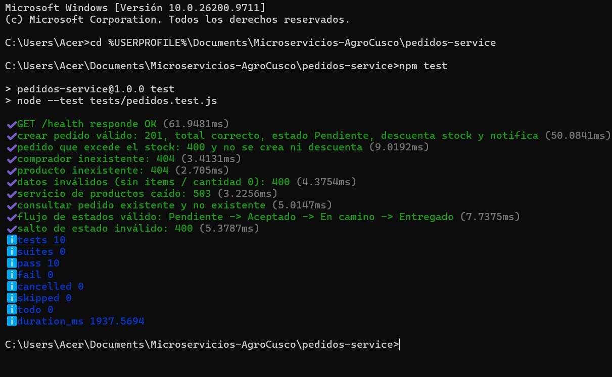

| N.º | Prueba | Comportamiento que se espera |
|---|---|---|
| 1 | GET /health responde OK | Estado 200 y service igual a pedidos-service. |
| 2 | Crear pedido válido | Estado 201, total correcto, estado Pendiente, se descuenta el stock y se envía una notificación. |
| 3 | Pedido que excede el stock | Estado 400; no se crea el pedido ni se descuenta stock. |
| 4 | Comprador inexistente | Estado 404. |
| 5 | Producto inexistente | Estado 404. |
| 6 | Datos inválidos (sin items o cantidad 0) | Estado 400. |
| 7 | Servicio de productos caído | Estado 503. |
| 8 | Consultar pedido | Estado 200 si existe y 404 si no existe. |
| 9 | Flujo de estados válido | Pendiente → Aceptado → En camino → Entregado, todos con estado 200. |
| 10 | Salto de estado inválido | Estado 400 al pasar de Pendiente a Entregado. |

```js
// Los otros microservicios se simulan
beforeEach(() => {
  app.reiniciar();
  descuentos = [];
  notificaciones = [];
  clientes.validarUsuario = async (id) => id === 1;
  clientes.obtenerProducto = async (id) => (id === 1 ? PRODUCTO : null);
  clientes.descontarStock = async (id, cantidad) => { descuentos.push([id, cantidad]); };
  clientes.notificar = async (uid, msg) => { notificaciones.push([uid, msg]); };
});

test('pedido que excede el stock: 400 y no se crea ni descuenta', async () => {
  const r = await crear(99);
  assert.equal(r.status, 400);
  assert.equal(descuentos.length, 0);
  assert.deepEqual(await (await enviar('GET', '/pedidos')).json(), []);
});

test('servicio de productos caído: 503', async () => {
  clientes.obtenerProducto = async () => { throw new Error('caído'); };
  assert.equal((await crear(1)).status, 503);
});
```

### 8.3 Pruebas de notificaciones-service

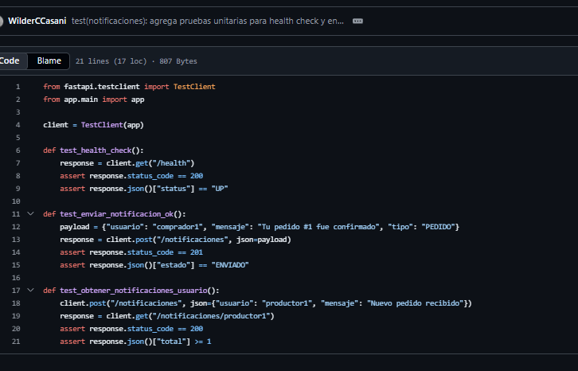

| N.º | Prueba | Comportamiento que se espera |
|---|---|---|
| 1 | test_health_check | Estado 200 y status igual a UP. |
| 2 | test_enviar_notificacion_ok | Estado 201 y la notificación queda con estado ENVIADO. |
| 3 | test_obtener_notificaciones_usuario | Estado 200 y el total de notificaciones del usuario es al menos 1. |

```python
client = TestClient(app)

def test_health_check():
    response = client.get("/health")
    assert response.status_code == 200
    assert response.json()["status"] == "UP"

def test_enviar_notificacion_ok():
    payload = {"usuario": "comprador1", "mensaje": "Tu pedido #1 fue confirmado", "tipo": "PEDIDO"}
    response = client.post("/notificaciones", json=payload)
    assert response.status_code == 201
    assert response.json()["estado"] == "ENVIADO"
```

## 9. Docker

Cada microservicio tiene su propio Dockerfile. En los de Node se copian primero los archivos `package*.json` y se instalan las dependencias, para que Docker reutilice esa capa mientras no cambien; en usuarios y pedidos se instala con `--omit=dev` para no meter dependencias de desarrollo. También hay un `.dockerignore` que deja fuera `node_modules` y el archivo `.env`. A continuación se ve el commit con el Dockerfile de usuarios.

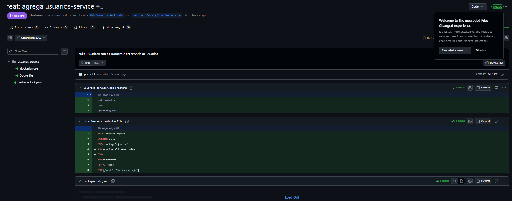

Para trabajar con los contenedores usamos Docker Desktop; esta es la versión instalada:

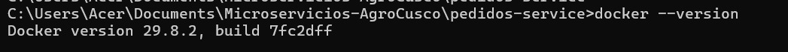

Como prueba, construimos la imagen de pedidos-service con `docker build` y la ejecutamos con `docker run`, publicando el puerto 8003 de la computadora en el 8000 del contenedor:

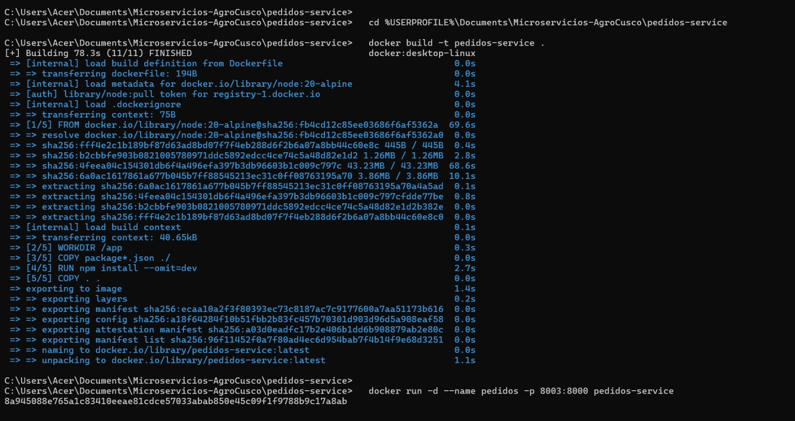

En Docker Desktop se ve el contenedor «pedidos» en ejecución, con el puerto 8003:8000:

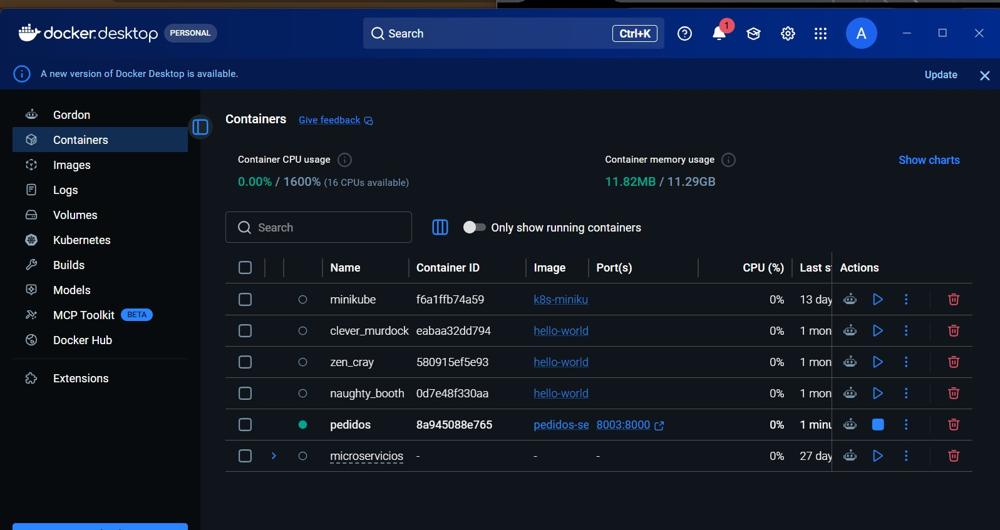

```dockerfile
# usuarios-service y pedidos-service
FROM node:20-alpine
WORKDIR /app
COPY package*.json ./
RUN npm install --omit=dev
COPY . .
ENV PORT=8000
EXPOSE 8000
CMD ["node", "src/server.js"]
```

```dockerfile
# productos-service
FROM node:18-alpine
WORKDIR /app
COPY package*.json ./
RUN npm install
COPY . .
EXPOSE 8002
CMD ["node", "src/server.js"]
```

```dockerfile
# notificaciones-service
FROM python:3.12-slim
WORKDIR /app
COPY requirements.txt .
RUN pip install --no-cache-dir -r requirements.txt
COPY . .
CMD ["uvicorn", "app.main:app", "--host", "0.0.0.0", "--port", "8000"]
```

Dentro de los contenedores de usuarios, pedidos y notificaciones el servicio escucha en el puerto 8000, que es el que usa pedidos-service para llamarlos (`http://usuarios:8000`, etc.). En productos-service el puerto es el 8002.

## 10. Integración continua con GitHub Actions

La pipeline de integración continua se ejecuta en cada push y Pull Request. Tiene que correr las pruebas de los servicios y comprobar que las imágenes de Docker se construyen bien.

## 11. Participación del equipo

La consigna pide que cada integrante tenga al menos tres commits y que nadie concentre más del 50 % del trabajo. Este es el resumen del historial del repositorio:

| Integrante (cuenta en GitHub) | Commits | Trabajo |
|---|---|---|
| Andrea Alejandra Hermoza Guevara | 3 | pedidos-service: endpoints, 10 pruebas y Dockerfile |
| Francys Raúl Tejada Taco (pachiskt) | 3 | usuarios-service: endpoints, 8 pruebas y Dockerfile |
| Beder Edison Achiri Sillo (Edison y Beder Edison) | 8 | productos-service: estructura base, conexión a MySQL y limpieza del repositorio; además creó el repositorio, hizo el commit inicial y fusionó los Pull Requests |
| Wilder Ronald Ccasani Quispe (Wilder CCasani) | 3 | notificaciones-service: endpoints, pruebas y Dockerfile |
| Albert Levita Zea | 2 | README.md con el informe del proyecto y pruebas |

## 12. Conclusiones

Separar el sistema en microservicios nos permitió repartir el trabajo: cada integrante se encargó de un servicio y pudo avanzar sin esperar a los demás. Trabajar con forks y Pull Requests nos obligó a revisar los cambios antes de unirlos y dejó un historial claro de quién hizo qué.

Las pruebas nos ayudaron a comprobar tanto los casos que salen bien como los errores (datos inválidos, stock insuficiente, servicios caídos), y Docker permite que todos ejecutemos los servicios en el mismo entorno. Como mejoras pendientes están guardar usuarios, pedidos y notificaciones en una base de datos, completar la actualización de productos, y dejar funcionando el docker-compose y la pipeline de GitHub Actions.
